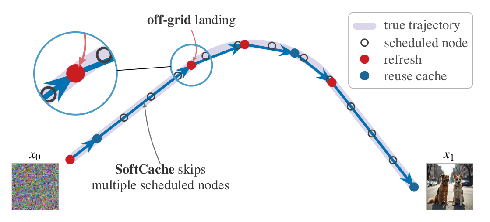
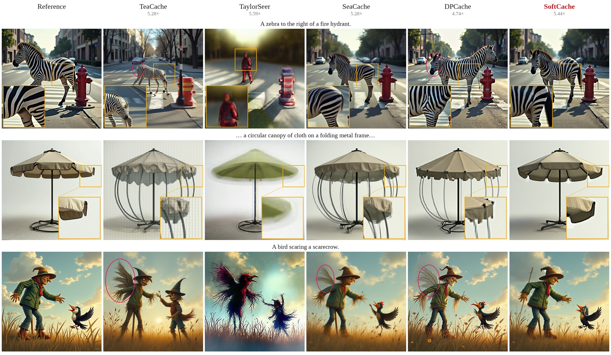
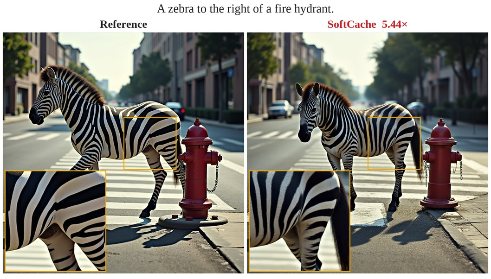

<h1 align="center">Official Implementation of SoftCache</h1>
<h3 align="center">Adaptive Step Size Caching for Diffusion Transformers</h3>

<p align="center">
  Shimon Malnick<sup>1</sup> ·
  Nadav Orenstein<sup>1</sup> ·
  Ohad Fried<sup>2</sup> ·
  Shai Avidan<sup>1</sup>
  <br>
  <sup>1</sup>Tel Aviv University &nbsp;&nbsp; <sup>2</sup>Reichman University
</p>

<p align="center">
  <a href="https://arxiv.org/abs/2610.22369"></a>
  <a href="https://www.malnick.net/softcache/"></a>
  <!-- add when the links exist: 🤗 demo · ComfyUI -->
</p>

<p align="center">
  <picture>
    <source media="(prefers-color-scheme: dark)" srcset="assets/teaser_dark.png">
    
  </picture>
</p>

**Training-free, 3.5×–6.9× faster sampling for FLUX.1-dev, HunyuanVideo and Wan2.1.**
Hard caching only decides whether to refresh or reuse. SoftCache also uses the cache's *headroom*
to set how far each cached step jumps, even between scheduled nodes, and it is ahead of every
baseline on all four fidelity metrics.

<p align="center">
  
  <br><sub>FLUX.1-dev on DrawBench at ≈5.2× (Fig. 4 of the paper). Red ellipses mark structural errors, and each inset enlarges one region.</sub>
</p>

## Quick start

From a clone (the exact tested stack, pinned in `uv.lock`):

```bash
git clone --recursive https://github.com/ShimonMalnick/softcache && cd softcache    # SeaCache is a submodule
uv sync
uv run softcache --prompts prompts.json --out outputs      # --model-family flux | hunyuan | wan
```

Or with pip (newest compatible `torch`, `diffusers` and `transformers`):

```bash
pip install git+https://github.com/ShimonMalnick/softcache
softcache --prompts prompts.json --out outputs
```

With pip, SeaCache's code is downloaded once from its repository into `~/.cache/softcache` on first use.

`prompts.json`: `[{"prompt": "A zebra to the right of a fire hydrant.", "seed": 0}]`

To use it from your own code, set the config once, then call `generate` for your model:

```python
import torch
from softcache import Config
cfg = Config(tau=0.8, beta=0.5)    # the paper's 5.2x FLUX band; lower tau = slower, closer to the reference
```

FLUX.1-dev:
```python
from diffusers import FluxPipeline
from softcache import flux

pipe = FluxPipeline.from_pretrained("black-forest-labs/FLUX.1-dev", torch_dtype=torch.bfloat16).to("cuda")
# stats: the step actions and node counts
image, stats = flux.generate(pipe, "A zebra to the right of a fire hydrant.", seed=0, cfg=cfg)
image.save("zebra.png")
```

<p align="center">
  
  <br><sub>This prompt with <code>tau=0.8, beta=0.5</code>, the paper's 5.2× FLUX band (5.44× band mean).</sub>
</p>

HunyuanVideo:
```python
from diffusers import HunyuanVideoPipeline
from diffusers.utils import export_to_video
from softcache import hunyuan

pipe = HunyuanVideoPipeline.from_pretrained("hunyuanvideo-community/HunyuanVideo", torch_dtype=torch.bfloat16).to("cuda")
pipe.vae.enable_tiling()
frames, stats = hunyuan.generate(pipe, "A cat walks on grass.", seed=0, cfg=cfg)
export_to_video(frames, "cat.mp4", fps=8)
```

Wan2.1:
```python
from diffusers import WanPipeline
from diffusers.utils import export_to_video
from softcache import wan

pipe = WanPipeline.from_pretrained("Wan-AI/Wan2.1-T2V-1.3B-Diffusers", torch_dtype=torch.bfloat16).to("cuda")
pipe.vae.enable_tiling()
frames, stats = wan.generate(pipe, "A cat walks on grass.", seed=0, cfg=cfg)
export_to_video(frames, "cat.mp4", fps=16)
```

## Options

| flag | default | |
|---|---|---|
| `--tau` | 0.30 | higher = faster; `0` = no caching (the baseline to time against) |
| `--beta` | 1.0 | 1.0 below ~4x speedup, 0.5 above |
| `--jf-max` | 8.0 | max jump length |
| `--device` | `cuda:0` | GPU to run on |
| `--low-memory` | off | encode all prompts first, then move the text encoders to the CPU |
| `--model`, `--steps`, `--height`, `--width`, `--num-frames`, `--guidance` | per model | |

FLUX.1-dev is gated on Hugging Face: accept its license and run `huggingface-cli login`.
Wan uses first-order Euler instead of its default UniPC scheduler.
## Gradio demo

FLUX only. Fits a 32 GB GPU (the text encoders and the transformer take turns on it).

```bash
uv run --with gradio python app.py              # add --share for a temporary public link
```

It opens with the zebra prompt at the ~5.4× preset. Pick a speed (3.8×, 5.4×, 6.9×), tick *Also run
uncached FLUX* to see the measured speedup on your GPU. Renders are cached in `demo_cache/`.

## Docker

```bash
docker build -t softcache .                      # clone with --recursive first (SeaCache submodule)
docker run --rm --gpus all -e HF_TOKEN -v ~/.cache/huggingface:/hf -v "$PWD":/work -w /work \
    softcache --prompts prompts.json --out outputs
```

Needs the NVIDIA Container Toolkit. The image runs the CLI, so every flag in *Options* works.

## ComfyUI

FLUX nodes for ComfyUI: see [`comfyui/ComfyUI-SoftCache`](comfyui/ComfyUI-SoftCache/README.md).

## Acknowledgements

This code is built on top of [SeaCache](https://github.com/jiwoogit/SeaCache) (used as the `third_party/SeaCache` submodule) and 🤗 [Diffusers](https://github.com/huggingface/diffusers).

## License

The SoftCache code is released under the [MIT License](LICENSE). The SeaCache submodule is not
part of this repository and stays under its authors' terms.

## Citation

```bibtex
@misc{malnick2026softcacheadaptivestepsize,
      title={SoftCache: Adaptive Step Size Caching for Diffusion Transformers},
      author={Shimon Malnick and Nadav Orenstein and Ohad Fried and Shai Avidan},
      year={2026},
      eprint={2610.22369},
      archivePrefix={arXiv},
      primaryClass={cs.CV},
      url={https://arxiv.org/abs/2610.22369},
}
```
